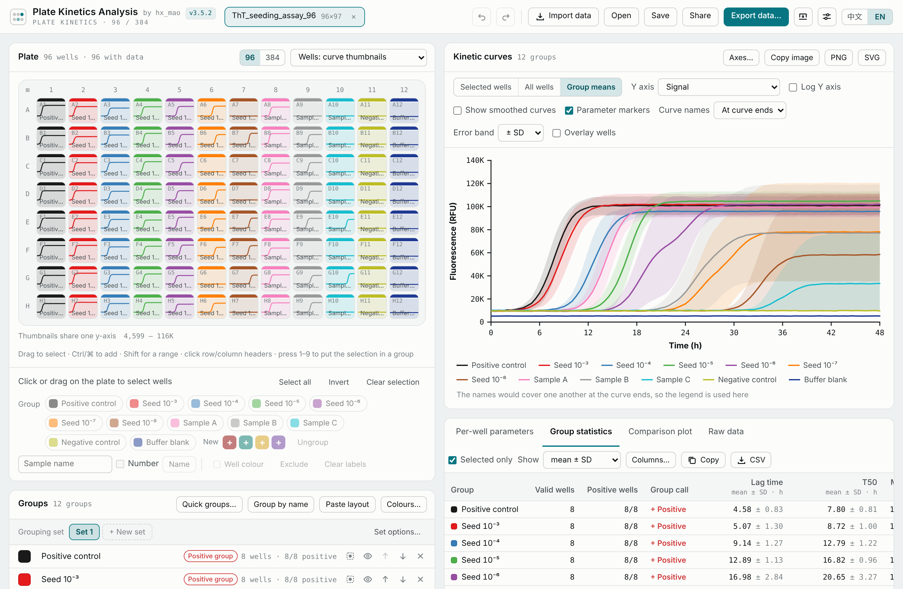
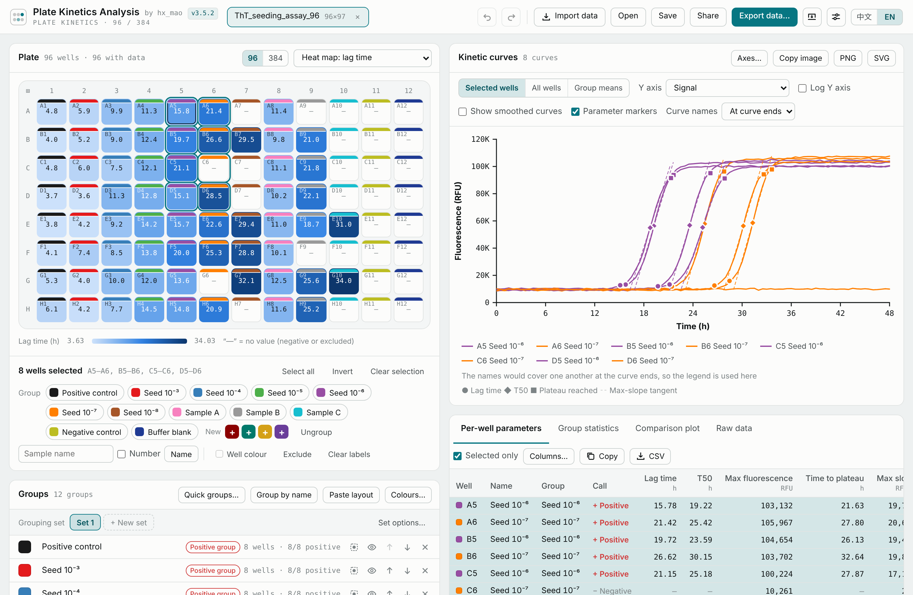
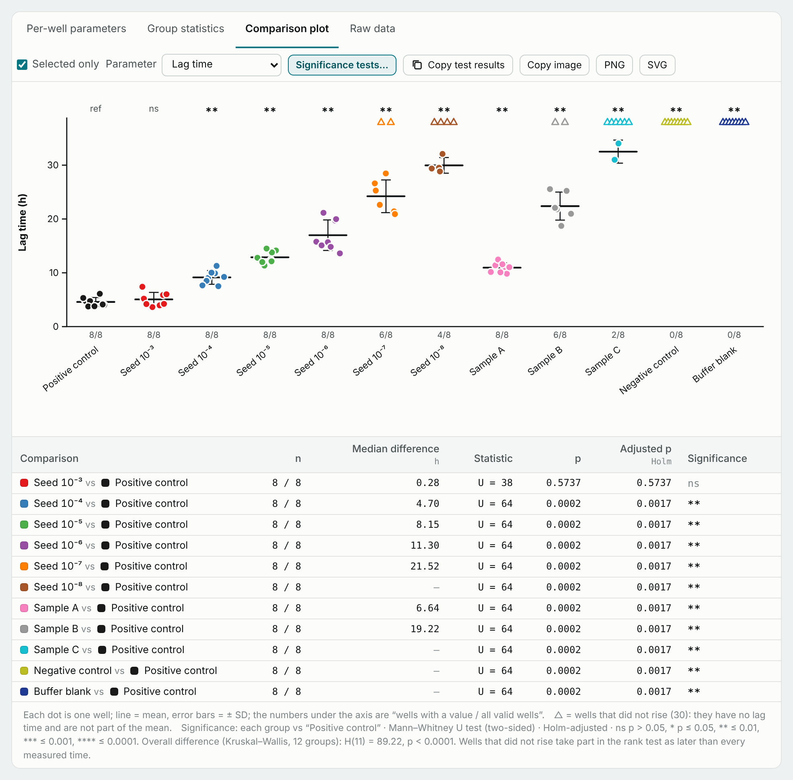
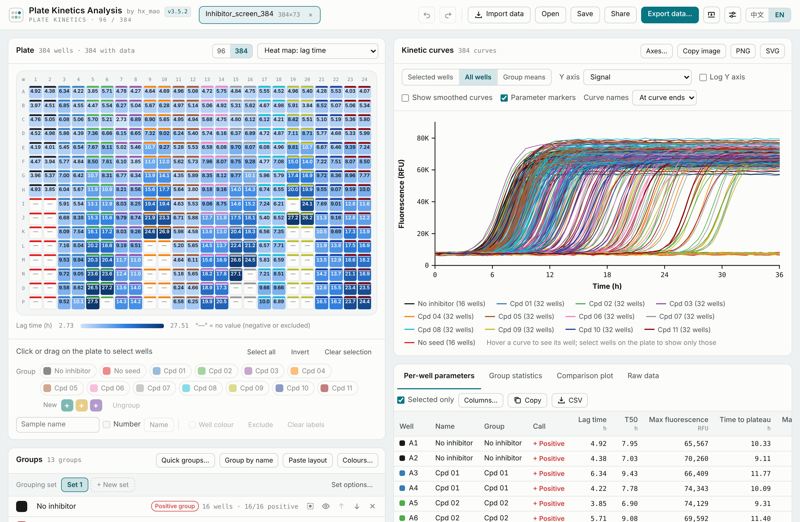

# Plate Kinetics Analysis

**Version 3.5.1 · hx_mao · MIT license**

Analyze kinetic curves from 96- and 384-well plates in a browser. Plate Kinetics Analysis brings instrument-file import, well grouping, curve parameters, group comparisons and figure export into a single HTML application.

**[Open the web application](https://kinetics.fow.mobi/)** · **[Download v3.5.1](https://github.com/hengxu2010/plate-kinetics-analysis/releases/tag/v3.5.1)** · **[Report an issue](https://github.com/hengxu2010/plate-kinetics-analysis/issues)**

The website is maintained separately and may run a different version. The v3.5.1 release preserves the specific application published here.

## Screenshots / 界面截图

The full-window screenshots show **v3.5.2**; the downloadable release linked above is **v3.5.1**. Click an image to view it at full size.

完整界面截图显示 **v3.5.2**，上方下载链接对应 **v3.5.1**。点击图片可查看原图。

| 96-well overview / 96 孔板总览 | Heat map and well selection / 热图与选孔 |
| --- | --- |
|  Per-well curve thumbnails, group mean kinetics and summary statistics. 单孔曲线缩略图、分组平均曲线及统计结果。 |  Lag-time heat map linked to selected-well curves and kinetic parameters. 起峰时间热图与选孔联动，显示所选孔的曲线及参数。 |
| **Group comparison / 组间比较** | **384-well analysis / 384 孔板分析** |
|  Individual wells, mean ± SD and Holm-adjusted Mann–Whitney U tests. 单孔数据、均值 ± SD，以及 Holm 校正的 Mann–Whitney U 检验。 |  Lag-time heat map and kinetic curves for all wells. 384 孔板起峰时间热图与全部孔动力学曲线。 |

## Features

- Import Excel workbooks, CSV and other text tables, or paste a table directly. Recognize common table layouts and locate wells, channels and time information.
- Read supported QPS, QPSX, Bio-Rad PCRD and BMG RUC instrument files. Import multiple files and select channels separately.
- Work with 96- or 384-well plates; name samples, create replicate groups, assign colors and exclude wells.
- Inspect kinetic curves and plate heat maps. Calculate baseline, maximum signal, lag time, T50, time to plateau, maximum slope and area under the curve, with configurable definitions and time windows.
- Summarize groups and compare them with the available statistical options, including Welch's t-test, Mann–Whitney and Fisher's exact test.
- Export SVG/PNG figures, Excel workbooks, CSV tables and HTML reports; save and reopen JSON projects.
- Switch between English and Chinese, and light and dark themes.

## Quick start

1. Open the [website](https://kinetics.fow.mobi/), or download `index.html` from the [v3.5.1 release](https://github.com/hengxu2010/plate-kinetics-analysis/releases/tag/v3.5.1) and open it in a current desktop browser.
2. Select **Import data** and choose your instrument export or spreadsheet.
3. Review the detected data area, channel, well mapping and time units. When the file contains cycle numbers without sampling times, supply the actual reading interval for time-based results.
4. Name and group wells, review exclusions, and choose analysis settings.
5. Inspect the curves and results, then export figures, tables or a report. Save a JSON project to resume the analysis later.

Local analysis needs no installation or build step. The spreadsheet reader is embedded in the HTML, so the analysis application can run offline. Recognition covers the implemented file layouts; check the import preview when working with a new instrument or export format.

## Local analysis and shared rooms

Ordinary file import and analysis are performed in the browser. Creating or editing a shared room sends the selected project data to the collaboration server. Shared rooms require a compatible server under `/api/collab/`; that server and the website administration system are not included in this HTML release. Opening this file locally or hosting it as a static page provides the standalone analysis workflow.

## Citation

hx_mao (2026). *Plate Kinetics Analysis v3.5.1: A Browser-Based Tool for 96- and 384-Well Kinetic Data* [Computer software]. https://doi.org/10.13140/RG.2.2.10226.06081

[ResearchGate software record](https://www.researchgate.net/publication/417781156_Plate_Kinetics_Analysis_v351_A_Browser-Based_Tool_for_96-_and_384-Well_Kinetic_Data) · [Fixed v3.5.1 release](https://github.com/hengxu2010/plate-kinetics-analysis/releases/tag/v3.5.1)

Machine-readable citation metadata is provided in [`CITATION.cff`](CITATION.cff).

## License

The original application code is released under the [MIT license](LICENSE), copyright hx_mao. The bundled SheetJS Community Edition 0.20.3 retains its Apache License 2.0 terms and notices, included in `index.html`. See [THIRD_PARTY_NOTICES.txt](THIRD_PARTY_NOTICES.txt).

## 中文说明

孔板动力学分析是一款在浏览器中运行的 96/384 孔板动力学分析工具，适用于酶标仪、实时 PCR 仪等设备的时间序列数据。作者：**hx_mao**。

- 支持 Excel、CSV 等表格和已实现解析的 QPS、QPSX、PCRD、RUC 仪器格式，可自动识别常见布局、孔位、通道与时间信息。
- 支持样本命名、重复孔分组、颜色设置、排除孔、动力学曲线和孔板热图。
- 可计算起峰时间、T50、达到平台期时间、最大斜率、AUC 等参数，并进行分组统计和比较。
- 可导出 SVG/PNG 图片、Excel/CSV 表格与 HTML 报告，也可保存和重新打开 JSON 项目。

使用时打开 [在线网站](https://kinetics.fow.mobi/)，或下载本仓库发布的 `index.html`，双击后在现代桌面浏览器中运行。导入后请核对通道、孔位及时间单位；只有循环数而没有实际采样时间时，需要填写真实读数间隔。

单机分析可离线完成。临时共享需要配套服务器，启用共享时所选项目数据会上传到服务器。本仓库发布的是独立 HTML 应用。网站由作者单独维护，可能与此处固定保存的 v3.5.1 版本不同。

采用 MIT 开源许可，内置第三方依赖保留各自许可。反馈问题时，请说明程序版本、浏览器和复现步骤；如需提供示例数据，请先去除不适合公开的信息。
