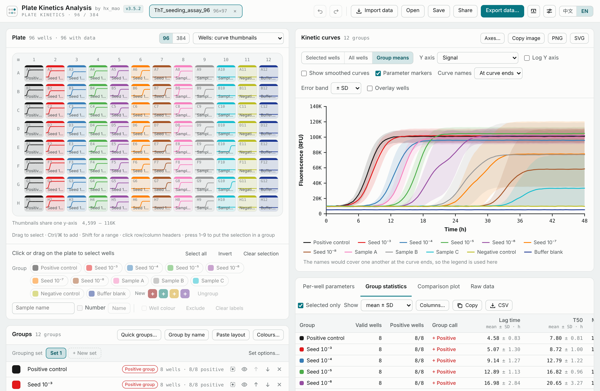
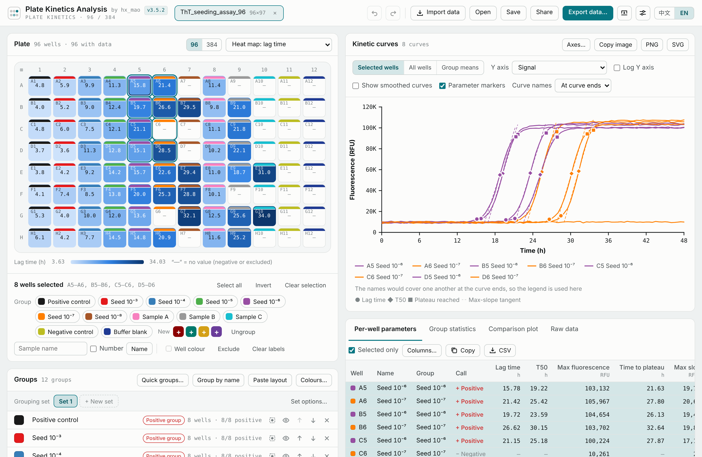
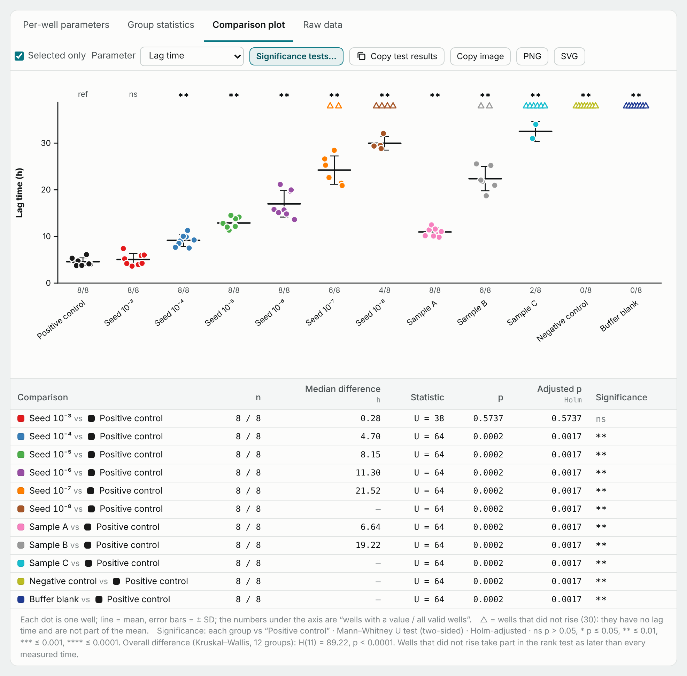
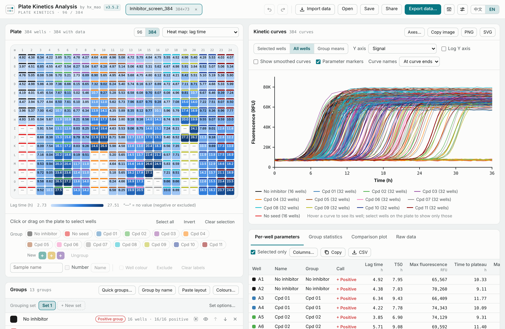

# Plate Kinetics Analysis

**Version 3.19.0 · hx_mao · MIT license**

Analyze kinetic curves from 96- and 384-well plates in a browser. Plate Kinetics Analysis brings instrument-file import, well grouping, curve parameters, group comparisons and figure export into a single HTML application.

**[Open the web application](https://tools.fow.mobi/kinetics/)** · **[Download v3.19.0](https://github.com/hengxu2010/plate-kinetics-analysis/releases/tag/v3.19.0)** · **[Report an issue](https://github.com/hengxu2010/plate-kinetics-analysis/issues)**

`index.html` in this repository is the offline copy of version 3.19.0, the version the website runs as of 2026-11-29. The website is maintained separately and may later run a newer version. Earlier releases stay available under [Releases](https://github.com/hengxu2010/plate-kinetics-analysis/releases) (v3.5.1 is the version the DOI below was registered for).

## Screenshots / 界面截图

The screenshots show **v3.5.2**; the layout of 3.19.0 differs in details (the analysis settings open as a strip from the top bar, and plates support multi-layer grouping). Click an image to view it at full size.

截图是 **v3.5.2** 的界面；3.19.0 的界面细节有所不同（分析设置从顶栏按钮展开成一条，孔板支持多层分组）。点击图片可查看原图。

| 96-well overview / 96 孔板总览 | Heat map and well selection / 热图与选孔 |
| --- | --- |
|  Per-well curve thumbnails, group mean kinetics and summary statistics. 单孔曲线缩略图、分组平均曲线及统计结果。 |  Lag-time heat map linked to selected-well curves and kinetic parameters. 起峰时间热图与选孔联动，显示所选孔的曲线及参数。 |
| **Group comparison / 组间比较** | **384-well analysis / 384 孔板分析** |
|  Individual wells, mean ± SD and Holm-adjusted Mann–Whitney U tests. 单孔数据、均值 ± SD，以及 Holm 校正的 Mann–Whitney U 检验。 |  Lag-time heat map and kinetic curves for all wells. 384 孔板起峰时间热图与全部孔动力学曲线。 |

## Features

- Import Excel workbooks, CSV and other text tables, or paste a table directly. Recognize common table layouts and locate wells, channels and time information.
- Read supported QPS, QPSX, Bio-Rad PCRD and BMG RUC instrument files. Import multiple files and select channels separately.
- Work with 96- or 384-well plates; name samples, create replicate groups (also quickly, from the selected wells with data), assign colors and exclude wells.
- Inspect kinetic curves and plate heat maps. Calculate baseline, maximum signal, lag time, T50, time to plateau, maximum slope and area under the curve, with configurable definitions and time windows. Drag the threshold and cut-off lines directly on the chart.
- Use one set of analysis settings for all datasets, or separate settings for each dataset.
- Summarize groups and compare them with the available statistical options, including Welch's t-test, Mann–Whitney and Fisher's exact test.
- Export SVG/PNG figures, Excel workbooks, CSV tables and HTML reports; save and reopen JSON projects, with a note per dataset.
- Switch between English and Chinese, and light and dark themes.

## What changed since 3.5.1

- **3.6** – analysis settings as a strip opened from the top bar; refreshed layout.
- **3.7** – quick grouping of the selected wells with data; the app can save itself as one HTML file for offline use (click the version badge).
- **3.8** – draggable threshold and cut-off lines; choice of the parameter markers shown on the chart; notes per dataset; positive wells keep their group color.
- **3.9.0** – analysis settings for all datasets alike or for each dataset separately.
- **3.9.1** – fixes: import (a title above the header, named wells among plain well ids, decimal commas, remark rows naming wells), statistics notes (median bounds, wells left out of the U test, the threshold used), the threshold and cut-off lines in exported figures, a warning when a negative control rises, exports of all datasets with their own settings, a slow start keeping the saved session, autosave retrying after a failure, and checks on shared-room data.
- **3.10** – more reliable file import; plate frame lines; several groups selected at once; group names can be removed; click a row or column label to select its wells; well selection and grouping in one panel; wide or square charts; exports name their source.
- **3.11** – splice: join two datasets of the same plate into a new one (wells matched by position, by actual time or back to back, the join marked by a dashed line that can be hidden); the original datasets stay unchanged.
- **3.12** – save model: Save writes back to the same project file (File System Access API), Save as (`Ctrl+Shift+S`), unsaved dot marker (`●`), and save a single experiment.
- **3.13** – grouping layers (up to 6 layers per plate: e.g., Sample, Dilution, Replicate) with Expand/Stack views, combinations, cross-tab statistics, per-layer frames and palettes, and reusable plate layouts.
- **3.15** – softer well-selection highlight, 6 default preset groups per layer with tick-to-assign checkboxes and stationary top `+ Add preset group`, 4-side multi-track outer margin labels (supporting partial/split plates and block badges), `Single | Stack | Split` mini-plates, comparison-plot stacked subdivision by a second layer, compact well-naming popover, Add-vs-Replace modal when opening a project, and visibility toggles for splice points and time-window shading.
- **3.16** – cross table follows the selected spread mode (mean ± SD / SEM / CV% / median) and chosen parameter columns, and exports separate mean and SD columns to copy/CSV.
- **3.17** – plate layout export on its own (SVG/PNG/PDF/Excel with brackets), PDF report in one step, continuous splice curves, a better notes editor.
- **3.18** – PDF layout and proportions, seven heat-map palettes (reversible), the Name column hidden by default, statistics and the cross table per grouping layer; a Windows desktop program (see below).
- **3.19** – opens the experiment files (`.pk`) of Plate Kinetics Live; changing the group of grouped wells takes two steps (take off the old tick first), so a stray click never moves wells; questions before actions that replace or discard work (Clear labels, Reset to defaults, closing a dataset, leaving a dialog with content) and undo that says what it undoes; exports keep to the wells and layers chosen (cross table with a "not grouped" column and n, a sheet of layer combinations); CSV cells that would run as formulas are protected; a project of a newer format is refused.

## Quick start

1. Open the [website](https://tools.fow.mobi/kinetics/), or download the HTML file from the [v3.19.0 release](https://github.com/hengxu2010/plate-kinetics-analysis/releases/tag/v3.19.0) and open it in a current desktop browser.
2. Select **Import data** and choose your instrument export or spreadsheet.
3. Review the detected data area, channel, well mapping and time units. When the file contains cycle numbers without sampling times, supply the actual reading interval for time-based results.
4. Name and group wells, review exclusions, and choose analysis settings.
5. Inspect the curves and results, then export figures, tables or a report. Save a JSON project to resume the analysis later.

On Windows, `PlateKineticsAnalysis-Setup.exe` from the same release installs the page as a desktop program (it opens .pkproj project files and .pk experiment files; it checks this repository's releases for updates and installs one only when its SHA-256 matches `SHA256SUMS.txt`).

Local analysis needs no installation or build step. The spreadsheet reader is embedded in the HTML, so the analysis application can run offline. Recognition covers the implemented file layouts; check the import preview when working with a new instrument or export format.

## Local analysis and shared rooms

Ordinary file import and analysis are performed in the browser. Creating or editing a shared room sends the selected project data to the collaboration server. Shared rooms require a compatible server under `/api/collab/`; that server and the website administration system are not included in this HTML release. Opening this file locally or hosting it as a static page provides the standalone analysis workflow.

## Citation

hx_mao (2026). *Plate Kinetics Analysis* (Version 3.19.0) [Computer software]. https://doi.org/10.13140/RG.2.2.10226.06081

The DOI was registered with version 3.5.1: [ResearchGate software record](https://www.researchgate.net/publication/417781156_Plate_Kinetics_Analysis_v351_A_Browser-Based_Tool_for_96-_and_384-Well_Kinetic_Data) · [Fixed v3.5.1 release](https://github.com/hengxu2010/plate-kinetics-analysis/releases/tag/v3.5.1)

Machine-readable citation metadata is provided in [`CITATION.cff`](CITATION.cff).

## License

The original application code is released under the [MIT license](LICENSE), copyright hx_mao. The bundled SheetJS Community Edition 0.20.3 retains its Apache License 2.0 terms and notices, included in `index.html`. See [THIRD_PARTY_NOTICES.txt](THIRD_PARTY_NOTICES.txt).

## 中文说明

孔板动力学分析是一款在浏览器中运行的 96/384 孔板动力学分析工具，适用于酶标仪、实时 PCR 仪等设备的时间序列数据。作者：**hx_mao**。当前版本 **3.19.0**（与 2026-11-29 起网站上的版本相同）。

- 支持 Excel、CSV 等表格和已实现解析的 QPS、QPSX、PCRD、RUC 仪器格式，可自动识别常见布局、孔位、通道与时间信息。
- 支持样本命名、多层重复孔分组（预设分组勾选赋组、四边外置分组标注、迷你孔板单层/叠加/分拆视图、布局复用）、颜色设置、排除孔、动力学曲线和孔板热图。
- 可计算起峰时间、T50、达到平台期时间、最大斜率、AUC 等参数，并进行分组统计、交叉表和叠层细分比较；阈值线和截止线可以在曲线图上直接拖动。
- 分析设置可以所有数据集统一，也可以每个数据集单独设置；每个数据集可以写实验备注。
- 可导出 SVG/PNG 图片、Excel/CSV 表格与 HTML 报告，也可保存和重新打开 JSON 项目（打开项目时可选择追加或替换当前实验）。

3.5.1 以后的主要变化：3.6 分析设置改为从顶栏展开的一条；3.7 快速分组、点左上角版本号可把程序存成一个 HTML 文件离线使用；3.8 可拖动的阈值线和截止线、参数标注可选、实验备注；3.9.0 分析设置“所有实验统一 / 每个实验单独”；3.9.1 修正导入识别、统计说明、导出图中的阈值线和截止线、自动保存等约二十处问题；3.10 读文件更可靠、孔板框线、一次选几个组、点行号列号选孔、曲线图可选宽或正方、导出注明来源；3.11 拼接：把同一块板的两个数据集按孔位接成一个新数据集；3.12 保存写回同一文件、另存为、未保存标记“●”、单独保存单个实验；3.13 多层分组（最多 6 层，展开/叠加、组合曲线与交叉表、每层独立框线与配色）和孔板布局复用；3.15 选孔视觉减淡、每层默认 6 个预设分组勾选赋组、顶部固定添加预设组按钮、四边多轨道外置标注与分半板支持、迷你孔板单层/叠加/分拆视图、数据比较叠层细分、项目追加/替换打开、拼接点与时间窗阴影显示开关；3.16 交叉表跟随「显示」（均值 ± SD / SEM / CV% / 中位数）与「显示列…」勾选的全部参数，复制与导出 CSV 拆为独立均值与 SD 列；3.17 单独导出孔板布局（SVG/PNG/PDF/Excel 带括号标注）、一步生成 PDF 报告、拼接曲线连续显示、实验备注编辑器；3.18 PDF 版式、7 种热图配色（可反转）、名称列默认隐藏、按分组层的统计与交叉表，以及 Windows 桌面版；3.19 可以打开 Plate Kinetics Live 的实验文件（.pk）；已分组的孔要换组须先去掉原来的 ✓，误点不会把孔挪走；清除标注、恢复默认、关闭数据集、关掉有内容的对话框之前先问，撤销会说明撤销了什么；导出严格按所选的孔和分组层（交叉表加“未分组”列和 n、分组组合表）；CSV 里会被当成公式的文字加了保护；更新版本保存的项目文件会被拒绝。

使用时打开 [在线网站](https://tools.fow.mobi/kinetics/)，或下载本仓库发布的 HTML 文件，双击后在现代桌面浏览器中运行。Windows 上也可以用同一发布里的 `PlateKineticsAnalysis-Setup.exe` 安装成桌面程序（打开 .pkproj 项目文件和 .pk 实验文件；检查更新时向本仓库的发布页查询，安装前核对 `SHA256SUMS.txt` 里的 SHA-256）。导入后请核对通道、孔位及时间单位；只有循环数而没有实际采样时间时，需要填写真实读数间隔。

单机分析可离线完成。临时共享需要配套服务器，启用共享时所选项目数据会上传到服务器。本仓库发布的是独立 HTML 应用；网站由作者单独维护，以后可能更新到更新的版本。

采用 MIT 开源许可，内置第三方依赖保留各自许可。反馈问题时，请说明程序版本、浏览器和复现步骤；如需提供示例数据，请先去除不适合公开的信息。
